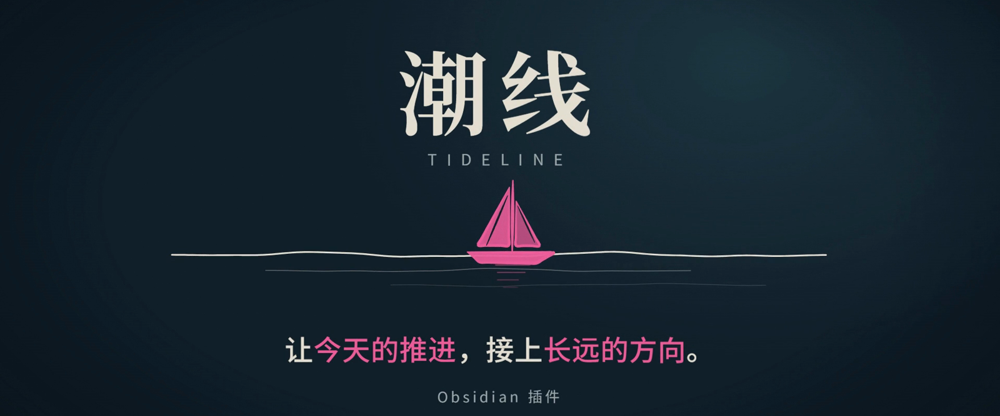
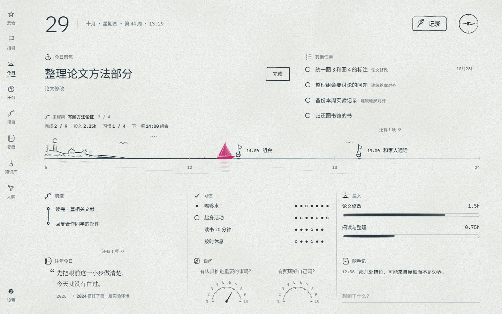
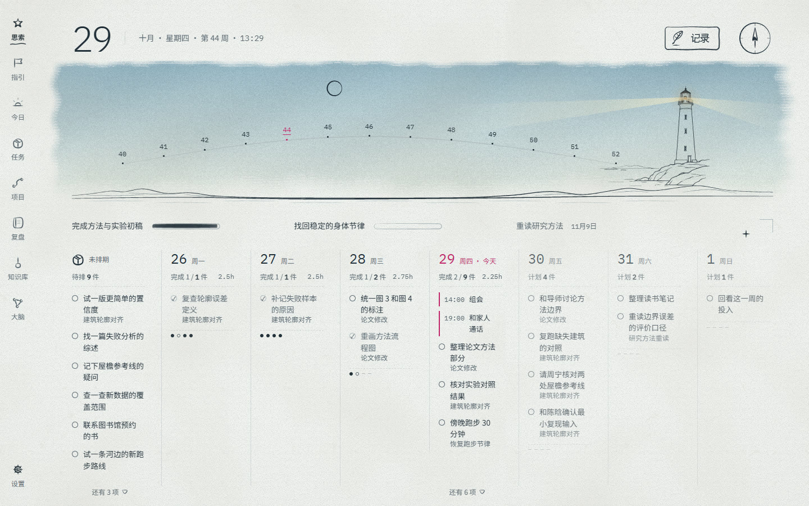
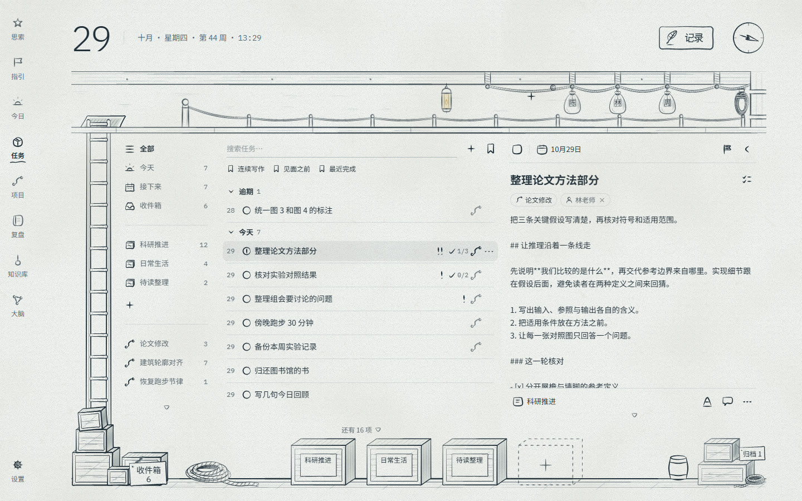
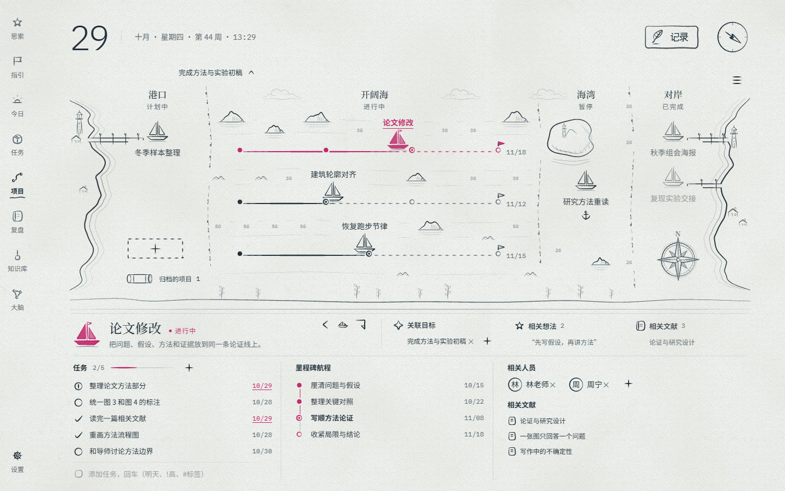
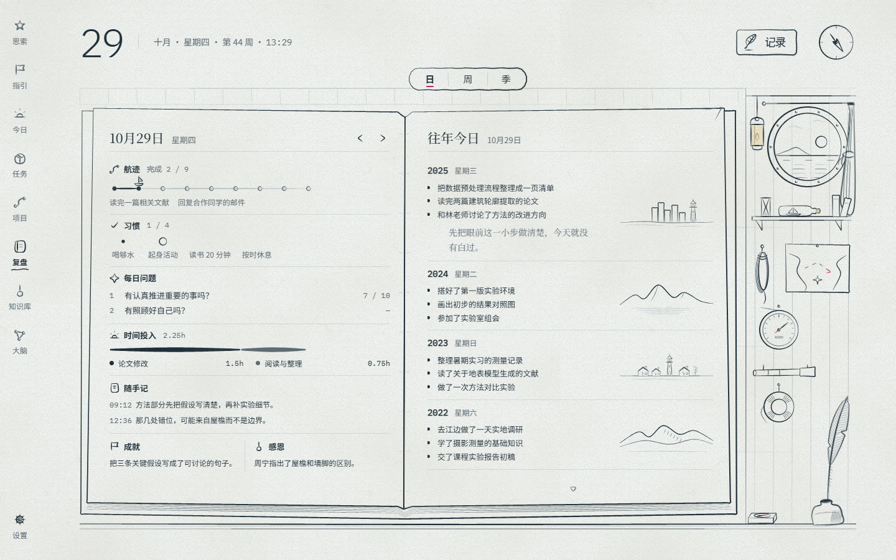
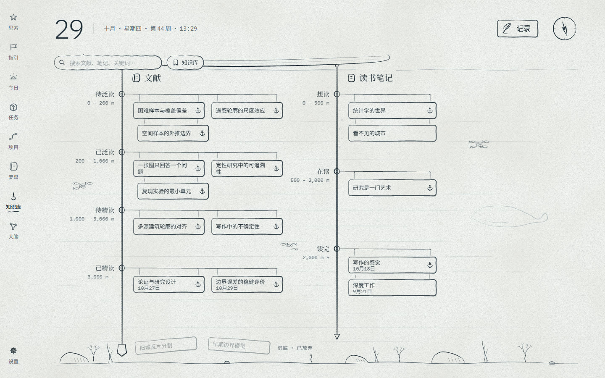
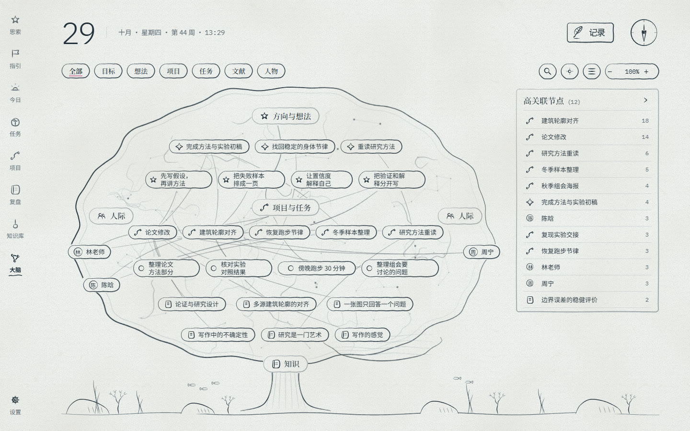
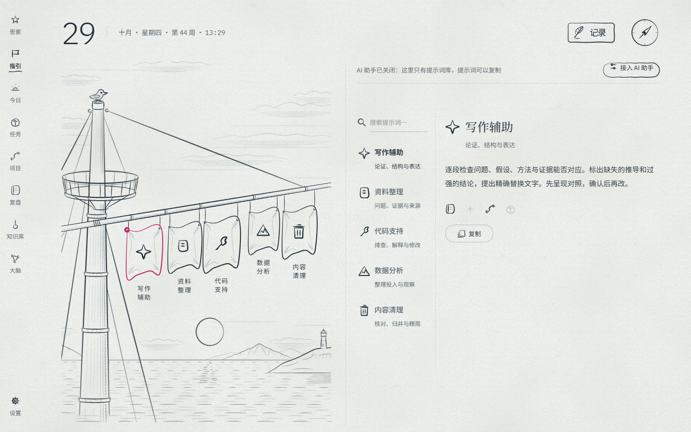

<div align="center">



# 潮线 · Tideline

一本手绘的航海速写本，住在你的 Obsidian 里。

<a href="../../releases"></a>


<a href="LICENSE"></a>
<a href="#-支持潮线"></a>

[看宣传片](#-宣传片) · [八张海图](#-八张海图) · [安装](#-安装) · [你的数据](#-你的数据始终是你的) · [支持潮线](#-支持潮线)

</div>

---

今天划掉了九件事——可它们，通向哪里？

潮线把 Obsidian 变成一片看得见的海：**海平线是此刻**，往上是这一季的方向与想法，往下是任务、项目、复盘和你读过的东西。每一件小事都挂在一条航线上，做完一件，船就往前一段。所有内容都是你仓库里的普通 Markdown 笔记。

## 🎬 宣传片

<div align="center">

<a href="docs/media/tideline-promo.mp4"></a>

**[▶ 观看完整宣传片（3 分 14 秒）](docs/media/tideline-promo.mp4)**

</div>

<!-- 宣传片上传到 B 站 / YouTube 以后，把上面两处链接换成视频页地址 -->

## 🧭 八张海图

<table>
<tr>
<td width="50%"><br><b>今日 · 海平线</b><br>日程是浮标，小船是现在。只盯一件要紧的事；做完的事沉到海平线下，成为航迹。习惯、自问、投入，是这一天的底色。</td>
<td width="50%"><br><b>思索 · 灯塔</b><br>灯塔照出这一季的每一周。目标写着每周想投入多少、什么时候到期；拖一下任务，就改了计划。想法和灵感也收在这里。</td>
</tr>
<tr>
<td><br><b>任务 · 货舱</b><br>每张清单是一只货箱。优先级、日期与重复、子任务、检查项、拖放与批量操作；要和谁当面说的事，装进他的邮包。</td>
<td><br><b>项目 · 海图</b><br>每个项目是一艘船，里程碑连成航线。所有项目一张海图看尽：港口里待出发，开阔海上在推进，海湾里暂歇。</td>
</tr>
<tr>
<td><br><b>复盘 · 航海日志</b><br>日、周、季三种视图：这一周船走了多远，这一季对照目标与生活之轮。</td>
<td><br><b>知识库 · 深海</b><br>读得越深，沉得越深。文献与书按阅读深度排开，可接 Zotero Integration 导入的文献笔记。</td>
</tr>
<tr>
<td><br><b>大脑 · 一棵树</b><br>目标、想法、项目、任务、文献和人，长成一棵关系树。选中一个，邻居一起亮起。</td>
<td><br><b>指引 · 桅顶</b><br>桅杆上的信号旗是你的提示词；也可以接上你自己装好的 AI 助手（可选，默认关闭）。</td>
</tr>
</table>

白天是纸，夜里是海——设置里可以换成夜航配色，字号也可以调。

## 📦 安装

> 0.9.7 试用版需要桌面 Obsidian 1.15.0 或更新版本，界面为简体中文。本次在 Windows 上验证，macOS 和 Linux 待实测。

在上架 Obsidian 社区插件目录之前，可以手动安装：

1. 从 [Releases](../../releases) 下载最新版本的 `main.js`、`manifest.json`、`styles.css`。
2. 放进仓库的 `.obsidian/plugins/tideline/` 文件夹（Obsidian 的配置文件夹不一定叫 `.obsidian`，以你的设置为准）。
3. 在 Obsidian 的「设置 › 第三方插件」中启用 Tideline。如果列表还没显示 Tideline，重启 Obsidian 后再查看。
4. 打开命令面板，运行「打开潮线」，也可以点 Obsidian 左侧栏的潮线图标。

第一次打开会进入「首次起航」。建议在空白仓库试用：仓库还没有任务或日记时，可以选择「装一套示例航程」。示例笔记带 `example` 标签，不计入统计。可在「设置 › 数据」中清除示例。

## 🗂 你的数据，始终是你的

- 每一笔都是仓库里的 Markdown：`日记/`、`任务/`、`项目/`、`人物/`、`目标/`、`想法/`、`文献/`、`书籍/`，设置与季度复盘在 `潮线/`。属性和正文的约定见 [docs/笔记格式.md](docs/笔记格式.md)。
- 插件只改它管的属性和正文小节，其余内容原样保留；删除按 Obsidian 的文件删除设置处理，部分操作会显示短暂的撤销入口。
- 卸掉插件，笔记原样还在，任何编辑器都能打开。

## 🔒 隐私与需要说明的地方

- **本地工作流**：今日、任务、项目、知识库与复盘可离线使用，无需注册潮线账号或付费。潮线没有广告或遥测。
- **日历订阅（可选）**：添加 iCal 地址后，潮线按设定的间隔请求该地址，并把日程缓存到本机。
- **AI 助手（可选，默认关闭）**：启用后，潮线会启动你自行安装的命令行代理，把提示词和你选择附带的笔记信息交给它。代理可能按自身权限读取文件或调用工具，并把所需内容发给对应服务商。账号、费用与数据处理方式取决于所选代理及服务商。
- **仓库以外的访问**：潮线会在系统路径及常见安装目录查找外部代理程序并启动它。外部代理进程的文件访问由代理权限和操作系统决定。
- **API 密钥**：插件内的密钥选择依赖 Obsidian 1.11.4 起提供的密钥库。潮线保存密钥的引用，启动或检查对应代理时通过环境变量传递密钥。
- **对话记录**：潮线把对话列表保存在 Obsidian 的本机存储中。代理或服务商可能另行保存会话，具体以其说明为准。你主动另存的对话会成为仓库笔记。
- **保护名单**：可在「设置 › 指引 › 权限与保护」配置。默认将当前仓库的 Obsidian 配置目录和潮线配置笔记列入禁止改动名单。已有自定义名单会继续使用。实际执行范围取决于代理是否执行保护规则、是否把读写和工具调用交给潮线审批。

## 🤖 AI 助手

指引页本身不包含任何 AI 模型或 SDK。它是一个 [ACP（Agent Client Protocol）](https://agentclientprotocol.com) 客户端：预设了 Claude Agent（`claude-agent-acp`）、Codex、Gemini CLI、CodeBuddy、DeepSeek Harness，也可以填自定义命令。先按各家说明安装并登录代理，再到 设置 › 指引 › 供应商 里开启、点“检查”。

## ♥ 支持潮线

如果潮线帮你把今天的推进接上了长远的方向，欢迎请近岸喝杯咖啡。赞赏是自愿的，用于维护插件、跟进 Obsidian 更新和打磨纸本界面。潮线的本地功能免费开放。

在插件「设置 › 关于 › 支持潮线」点「请近岸喝杯咖啡」，用手机微信扫一扫。赞赏码会随潮线的纸本或夜航配色切换。你也可以在这里打开 [浅色赞赏码](docs/media/wechat-sponsor-light.jpg) 或 [深色赞赏码](docs/media/wechat-sponsor-dark.jpg)。

也欢迎给仓库点一颗 ⭐，或在 [Issues](../../issues) 分享使用反馈。

## 🛠 从源码构建

需要 Node.js 20 以上。

```bash
npm ci
npm run sandbox
node tools/build.mjs --deploy sandbox-vault
```

上面的命令生成带虚构数据的 `sandbox-vault/`，构建到 `dist/`，并安装到沙盒。用 Obsidian 将 `sandbox-vault/` 作为仓库打开，启用 Tideline，运行「打开潮线」。只需要生成发行文件时，运行 `npm run build`。

`src/draw/proto/` 下的文件由作者的纸本设计原型生成（原型不在本仓库），请直接在这里修改，或在 issue 里提出。

## 🙏 致谢与许可

- 笔压线条用 [perfect-freehand](https://github.com/steveruizok/perfect-freehand)，AI 回复的 Markdown 用 [marked](https://github.com/markedjs/marked) 渲染，数字用 [IBM Plex Mono](https://github.com/IBM/plex)，手写字的骨架取自 [Noto Sans SC](https://github.com/notofonts/noto-cjk)。完整清单与许可原文见 [THIRD_PARTY_NOTICES.md](THIRD_PARTY_NOTICES.md)。
- 宣传片由插件界面与同一画风的手绘动画制作，配乐为程序合成。
- 代码以 [MIT 许可](LICENSE) 发布。

<div align="center">
<sub>潮线 · Tideline —— 让今天的推进，接上长远的方向。</sub>
</div>
